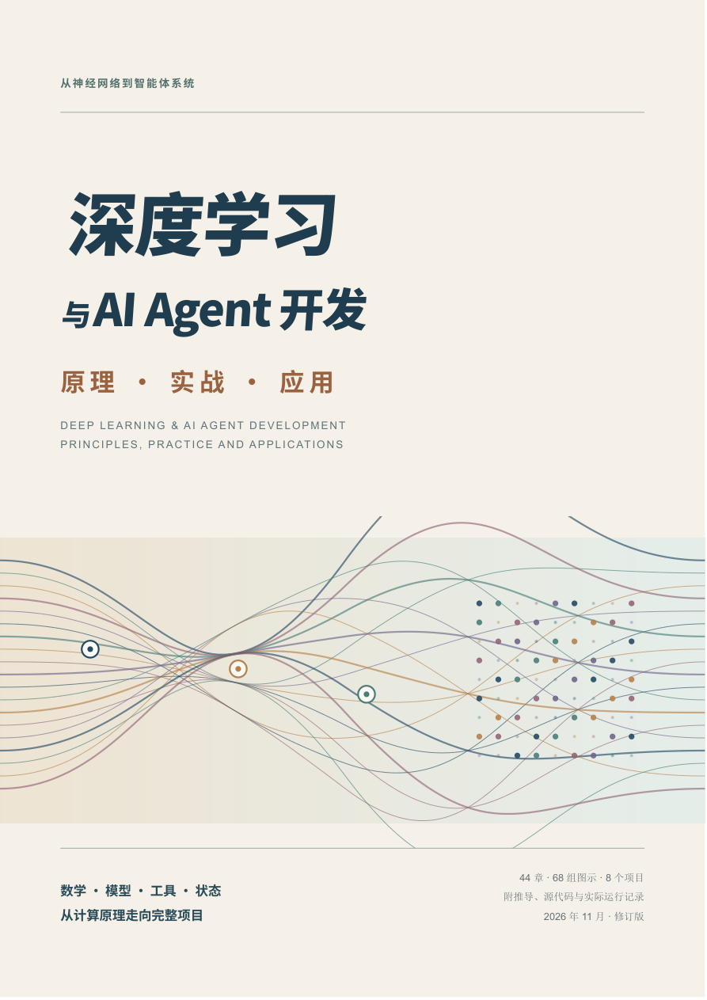
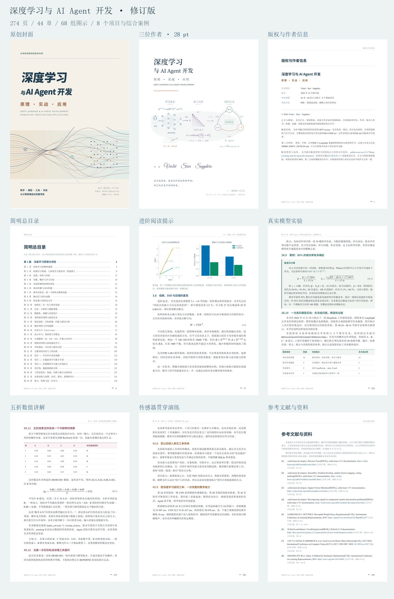

# 深度学习与 AI Agent 开发

### 原理 · 实战 · 应用

**Violet · Star · Sapphire** ｜ 2026 年 11 月修订版

**[直接在线阅读](https://wxy11117.github.io/Deep-Learning-and-AI-Agent-Development/)** · [阅读 / 下载 PDF](https://wxy11117.github.io/Deep-Learning-and-AI-Agent-Development/book.pdf) · [下载完整离线资料包](https://github.com/wxy11117/Deep-Learning-and-AI-Agent-Development/releases/download/v2026.11/Deep-Learning-and-AI-Agent-Development-materials-v2026.11.zip) · [版本发布页](https://github.com/wxy11117/Deep-Learning-and-AI-Agent-Development/releases/tag/v2026.11)



从模型怎样学习，到智能体怎样调用工具、维护状态并完成任务。本书以通俗小例子、数学推导、图示和项目实验串联机器学习、深度学习与 AI Agent 开发。

- **274 页 · 44 章 · 68 组正文图示 · 8 个基础项目**
- 76 条参考文献，含可导入文献管理器的 BibLaTeX 文件
- 92 处入门讲解与 7 个近年应用案例
- 另附 LungSight 公开资料案例、真实模型调用记录与传感器贯穿演练

在线阅读页与离线 HTML 使用同一份文件，图片、公式样式及所需字体已内嵌。打开上方链接即可阅读，无需安装 Python，也无需 API 密钥。完整资料包可下载后离线使用。

<br clear="all">

## 从哪里开始

| 需要 | 入口 |
|---|---|
| 直接读书 | [在线阅读](https://wxy11117.github.io/Deep-Learning-and-AI-Agent-Development/)，含章节导航与手机布局 |
| 打印或批注 | [PDF 精排版](https://wxy11117.github.io/Deep-Learning-and-AI-Agent-Development/book.pdf)，含目录、书签与页内跳转 |
| 保存完整材料 | [完整资料 ZIP](https://github.com/wxy11117/Deep-Learning-and-AI-Agent-Development/releases/download/v2026.11/Deep-Learning-and-AI-Agent-Development-materials-v2026.11.zip)，含 PDF、HTML、源稿、代码、数据和实验记录 |
| 了解阅读顺序 | [阅读指南](textbook/阅读指南.md) |
| 查找章节源稿 | [44 章 Markdown](textbook/新版章节/) |
| 跑一个模型项目 | [模型与检索项目索引](textbook/projects/README.md) |
| 跑一个 Agent 项目 | [Agent 项目索引](textbook/agent_projects/README.md) |
| 查看真实模型实验 | [LungSight 教学案例](textbook/case_study/lungsight/README.md) |
| 查出处和许可 | [参考文献](textbook/参考文献.md) · [版权与许可](LICENSE.md) · [第三方说明](THIRD_PARTY_NOTICES.md) |

## 材料目录

```text
docs/
  index.html              在线 / 离线阅读文件
  book.pdf                PDF 精排版
  assets/                 封面、作者页与排版预览
textbook/
  新版章节/               44 章源稿
  figures/                图示及绘图源文件
  projects/               5 个模型与检索项目、数据和保存结果
  agent_projects/         3 个 Agent 项目、工具与验证记录
  case_study/lungsight/   固定来源快照、任务集与真实调用记录
  experiment/             补充实验与输出
  publication/            文献、许可范围和出版核对资料
  vendor/                 随书使用的第三方排版资源及许可
  *.py / *.mjs / *.css     教学程序、构建与检查脚本
  *.md / *.json           阅读说明、源稿与检查记录
LICENSE.md                各类资料的版权与授权范围
LICENSE-CODE.txt          原创配套代码的 MIT 许可全文
THIRD_PARTY_NOTICES.md     第三方资料来源与许可
```

仓库保留项目原有的相对路径。所有项目命令均在 `textbook/` 中运行；完整资料 ZIP 的解压目录对应这里的 `textbook/`，并额外包含同目录的 PDF、HTML 与预览图。文件对应关系与 SHA-256 见 [分发清单](textbook/publication/github_distribution.json)。

## 第一次运行

先安装 Python 3.11 或 3.12。下面的知识库项目只用 Python 标准库，执行的是离线模型回复与实际本地工具：

```powershell
git clone https://github.com/wxy11117/Deep-Learning-and-AI-Agent-Development.git
cd Deep-Learning-and-AI-Agent-Development/textbook
python agent_projects/run_projects.py --project knowledge
```

结果写入 `agent_projects/results/knowledge_trace.json`，可看到搜索、读取与引用核验过程。再次运行会更新相应结果；如需保留随书记录，先另建实验副本。

模型项目先安装依赖，再选择一个项目运行：

```powershell
python -m pip install -r requirements-projects.txt
python projects/run_projects.py --project digits
```

| 项目 | 单独运行的命令 |
|---|---|
| 共享单车需求预测 | `python projects/run_projects.py --project bike` |
| 手写数字分类 | `python projects/run_projects.py --project digits` |
| 模拟传感器去噪 | `python projects/run_projects.py --project sensor` |
| 模拟缺陷分割 | `python projects/run_projects.py --project segmentation` |
| 设备手册检索 | `python projects/run_projects.py --project retrieval` |
| 知识库 Agent | `python agent_projects/run_projects.py --project knowledge` |
| 订单分析 Agent | `python agent_projects/run_projects.py --project analysis` |
| 工单流程 Agent | `python agent_projects/run_projects.py --project workflow` |

单车数据首次运行需要下载。模拟传感器、缺陷、手册、订单与工单的来源在各章和项目说明中标注。三个基础 Agent 项目默认离线运行；真实模型实验另见 `case_study/lungsight/`，重新调用需本机配置、显式 `--live` 和独立输出目录，并产生服务商费用。

## 书稿与验证记录

- 阅读路线：基础与训练 → 网络架构 → 实际项目 → 语言模型与检索 → Agent 工程与应用。
- [示例验证记录](textbook/示例验证记录.md)汇总数值复算、工具测试、真实调用和版式检查。
- [参考文献表](textbook/参考文献.md)与 [references.bib](textbook/publication/references.bib)提供论文、文档和数据出处。
- [阅读指南的构建部分](textbook/阅读指南.md#重新生成书籍)说明如何重新生成书籍。原排版环境为 Windows，修改字体或操作系统后应重新核对分页。
- 原创代码的具体授权文件及哈希见 [代码许可清单](textbook/publication/code_license_scope.json)，清单内路径相对于 `textbook/`。

`docs/index.html` 与 `docs/book.pdf` 是当前成书的规范入口；重新构建会在 `textbook/` 下生成中文文件名的 HTML 和 PDF。发布时将这两个结果分别同步到 `docs/index.html` 和 `docs/book.pdf`。GitHub Pages 从 `main` 分支的 `docs/` 发布。

<details>
<summary>查看排版预览</summary>



</details>

## 版权与使用

© 2026 Violet、Star、Sapphire。

教材正文、原创图表、封面与作者扉页保留版权；引用请注明书名、作者、版本和章节。为本书编写且列入许可清单的原创代码采用 **MIT License**。模型权重、数据、实验输出、第三方软件、字体与 LungSight 来源快照按 [LICENSE.md](LICENSE.md) 和 [THIRD_PARTY_NOTICES.md](THIRD_PARTY_NOTICES.md) 中的对应范围处理。

本仓库集中提供本书配套资料与代码，版权说明与书内“版权与作者信息”保持一致。勘误或使用问题可在 [Issues](https://github.com/wxy11117/Deep-Learning-and-AI-Agent-Development/issues) 中提交，请注明章节、页码和复现步骤。
